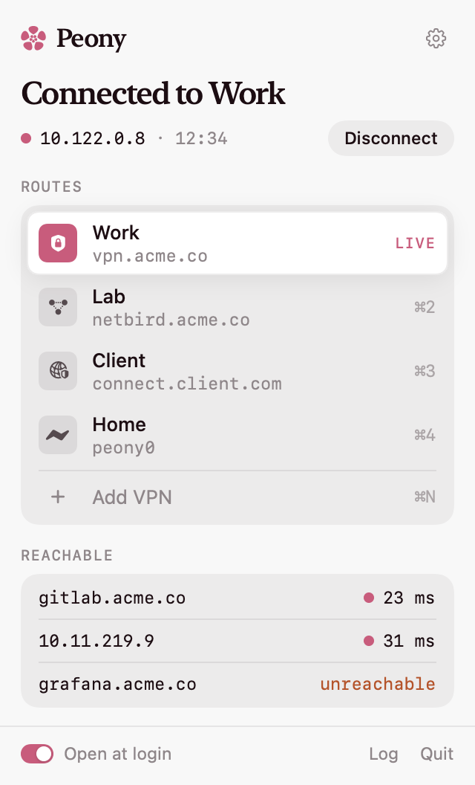

<p align="center"></p>

<h1 align="center">Peony</h1>

<p align="center">One VPN at a time, from the menu bar.</p>

<p align="center"></p>

Peony switches between your VPNs and keeps only one on, so their routes and DNS never fight. Once a tunnel is up, it checks the hosts you care about, so "connected" means you can reach them.

It works with FortiGate, AnyConnect, GlobalProtect, Pulse, F5, OpenVPN, WireGuard, NetBird and Tailscale.

## Install

```sh
brew install --cask pungrumpy/tap/peony
```

Peony isn't notarized yet. The first time you open it, go to **System Settings › Privacy & Security** and click **Open Anyway**.

Peony drives the open-source clients, so install the ones your VPNs need:

| VPN | Client |
| --- | --- |
| FortiGate SSL-VPN | `brew install openfortivpn` |
| AnyConnect, GlobalProtect, Pulse, F5, Array | `brew install openconnect` |
| OpenVPN | `brew install openvpn` |
| WireGuard | `brew install wireguard-tools` |
| Tailscale | `brew install --cask tailscale-app` or [Tailscale's Mac app](https://tailscale.com/download/mac) |
| NetBird | [NetBird's installer](https://docs.netbird.io/how-to/installation) |

## Use

1. Click the flower in the menu bar, then **Add VPN**.
2. Pick the kind, fill in what your admin gave you, and list a few hosts to check.
3. Click a route, or press <kbd>⌘1</kbd>–<kbd>⌘9</kbd>. Peony turns any other VPN off first.

The first connection asks for an admin password once, to install the helper. A FortiGate that signs in with single sign-on, such as Microsoft Entra, works too: choose **Browser (SSO)** and Peony opens the sign-in page in its own window.

## Drive Peony from scripts and agents

The cask puts `peony` on your `PATH`. Without Homebrew, run `/Applications/Peony.app/Contents/Helpers/peony`.

```sh
peony list                 # your VPNs, and which one is active
peony status               # the tunnel: state, address, failure and its fix, host checks
peony connect <name|id>    # turns any other VPN off, connects, waits until it's on or failed
peony disconnect           # turns the active VPN off and waits until it's off
```

Add `--json` for one JSON object on stdout, the same shape for every command, and `--timeout <seconds>` to change how long `connect` (90 by default) or `disconnect` (30) waits. A name matches exactly, ignoring case; use the id when two VPNs share one. `connect` is done once the VPN is on and each host has been checked:

```json
{
  "outcome": "done",
  "tunnel": {
    "address": "10.212.134.5",
    "hosts": [
      { "host": "git.example.com", "ms": 23, "status": "reachable" },
      { "host": "wiki.example.com", "status": "unreachable" }
    ],
    "since": "2026-10-29T09:12:03Z",
    "state": "on",
    "vpn": { "id": "6F1C0E52-0B7D-4C1A-9E43-2B1D8A6E7F10", "name": "Office" }
  },
  "version": 1,
  "vpns": [
    { "active": true, "endpoint": "vpn.example.com", "hosts": ["git.example.com", "wiki.example.com"],
      "id": "6F1C0E52-0B7D-4C1A-9E43-2B1D8A6E7F10", "kind": "forti", "name": "Office" }
  ]
}
```

| Exit | Meaning |
| --- | --- |
| 0 | Done: connected, disconnected, or status answered |
| 1 | The VPN failed. `.tunnel.failure` says why, and `.fix.command` holds an install command when one would fix it |
| 2 | Usage error |
| 3 | Peony isn't available: not running (for `list` and `status`), didn't open, a different version, or a sandbox blocked the socket |
| 4 | No VPN by that name, or more than one |
| 5 | Timed out while the tunnel was still changing. `.tunnel.signingIn` is true when a browser sign-in is waiting on you |
| 6 | Interrupted: someone else connected or disconnected, or the sign-in window was closed |

`list` and `status` never open Peony. `connect` and `disconnect` open it if it isn't running. `peony` talks to the app over a socket only your account can use, at `~/Library/Application Support/Peony/control.sock`, and the app stays the only thing that starts or stops a tunnel. Passwords, certificate trust, the helper, the log and editing VPNs stay in Peony's window.

## How it works, and what runs as root

Setting routes and DNS needs root. Peony installs a small helper and a sudoers rule that lets your account run it without a password. The helper:

- takes one JSON request on stdin, never secrets in arguments;
- validates every field, rejecting line breaks, option-like values, WireGuard `PostUp`/`PreDown` hooks, and any OpenVPN option that runs a script, loads a plugin or opens a file;
- only executes clients from Homebrew's `bin` and `sbin` directories;
- writes configs to a root-only directory, and deletes FortiGate's and OpenVPN's as soon as they have been read. OpenVPN's password file stays until the tunnel closes, because OpenVPN reads it again to renegotiate and reconnect.

Passwords and WireGuard and OpenVPN configs live in your Keychain. Remove everything with `brew uninstall --zap peony`.

## Develop

You need [Bun](https://bun.sh) and the Command Line Tools. Xcode isn't required.

```sh
bun install
bun run dev           # the app and the site (localhost:3000)
bun run test          # core tests
bun run build         # Peony.app and the site
bun run package       # .dmg, .zip, checksums and the Homebrew cask
bun run install-app   # build, copy to /Applications, relaunch
bun run snapshots     # re-render every panel state
bun run icon          # regenerate the app icon
```

Add `--filter=@peony/macos` or `--filter=web` to run a task for one of them.

| Path | What |
| --- | --- |
| `packages/core` | Profiles, validation, log parsers and reachability, shared with the helper. Has the tests. |
| `apps/macos` | The app, its panel views, the root helper, the `peony` command, and the snapshot renderer. |
| `apps/web` | The site. It shows the panel snapshots from `apps/macos/Design`. |

Describe a change to the app with `bun changeset`. When changesets reach `main`, a workflow opens a "Version Packages" pull request; merging it bumps the version, tags it and publishes the `.dmg`, and [the tap](https://github.com/PunGrumpy/homebrew-tap) picks it up within the hour.

The site deploys with each release, not on every push to `main`, so it never links to a download that isn't there yet. To publish a change that only touches the site, run the **Deploy website** workflow.

See [CONTRIBUTING](.github/CONTRIBUTING.md) and the [security policy](.github/SECURITY.md).

## License

[MIT](LICENSE)
